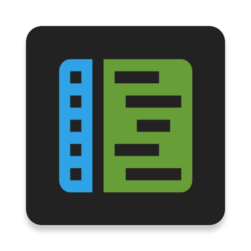
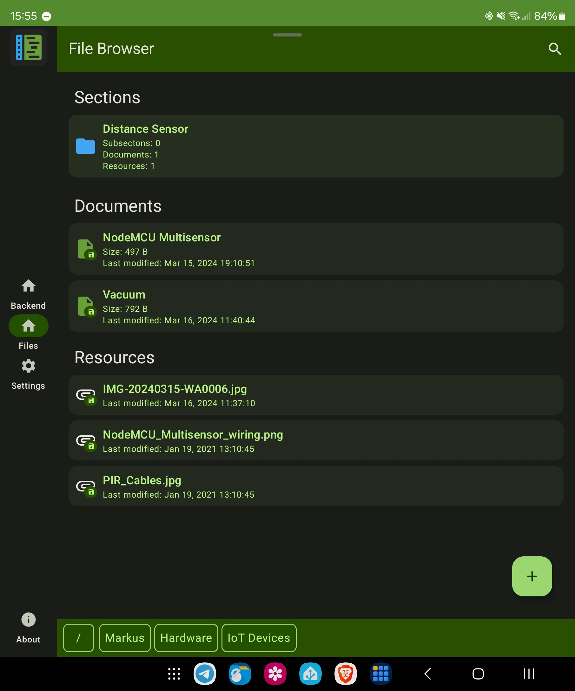
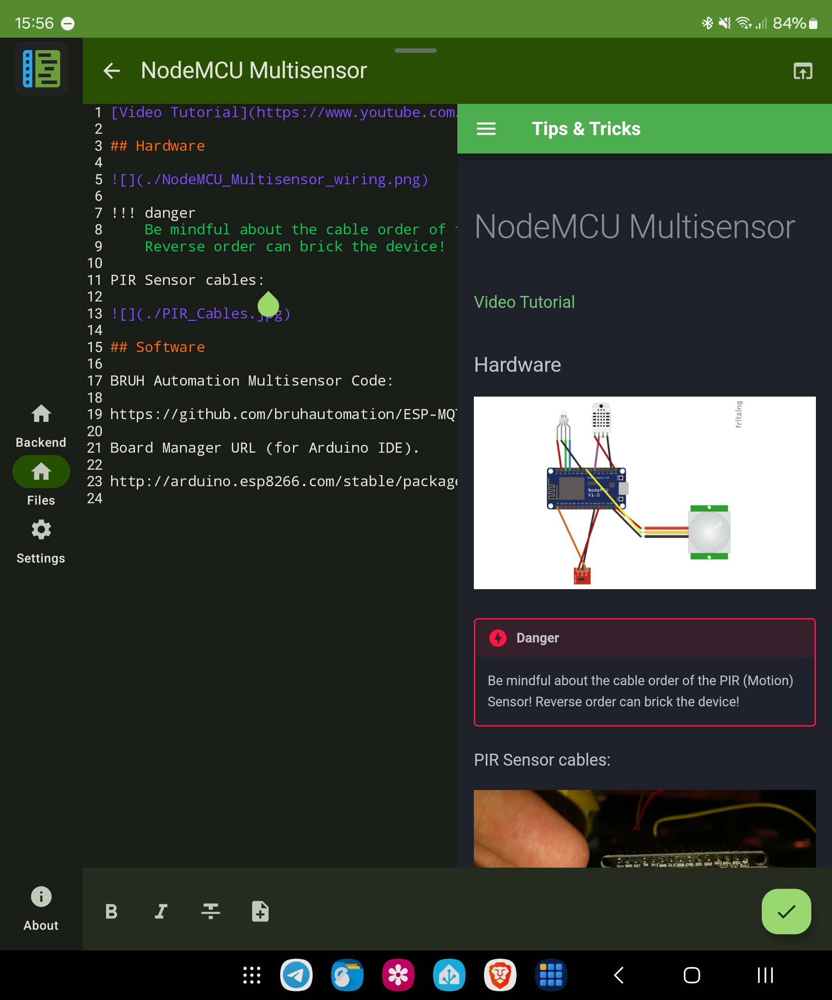

    

# MkDocsEditor

A realtime collaborative editor for MkDocs projects.

# :warning: Work In Progress

This project is still a work in progress and is **not yet ready for production**.

# What is this?

MkDocsEditor aims to provide an easy way for you to manage your existing [MkDocs](https://www.mkdocs.org/) projects:
* [ ] Section management (folders)
  * [x] create sections
  * [x] rename sections
  * [ ] move an entire section to another location
  * [x] delete a section and all the content inside it
* [ ] Document management (`*.md` files)
  * [x] create documents
  * [x] rename documents
  * [x] edit documents in realtime
    * [x] Quick formatting toolbar
    * [x] Syntax highlighting
    * [x] Markdown preview
  * [x] see the result on your hosted website right away
  * [ ] move a document
    * [ ] move all resources that are referenced in it, if possible
  * [x] delete documents
    * [ ] delete unused resources that are referenced in it
* [ ] Resource file management (any file that is not a markdown file really)
  * [x] upload resource files
  * [x] download linked resources
  * [x] open/share linked resources (if supported by another app on your device)
  * [x] delete resource files
    * [ ] automatically replace any reference to this resource in a document with a "deleted" note
* [x] Search
* [x] Full Offline Cache

## Realtime collaborative editing

MkDocsEditor is built around the famous [Differential Synchronization](https://neil.fraser.name/writing/sync/)
algorithm developed by [Neil Fraser](https://neil.fraser.name/) which allows
you to edit a document simultaniously while someone else is also editing.

**TODO: insert gif here**

# How to use

## Server setup

To use this app an instance of [MkDocsEditor-Backend](https://github.com/MkDocsEditor/MkDocsEditor-Backend) needs to run on the server
where your [MkDocs](https://www.mkdocs.org/) project source files are located.
Have a look at the documentation on it's [project site](https://github.com/MkDocsEditor/MkDocsEditor-Backend) to learn more
on how to do this.

## Installation

Every build of `master` is published as a pre-release with the APK on the
[releases page](https://github.com/MkDocsEditor/MkDocsEditor-Android/releases).
The easiest way to install it and get updates is [Obtainium](https://github.com/ImranR98/Obtainium):

1. Install Obtainium.
2. Open [this link](https://apps.obtainium.imranr.dev/redirect?r=obtainium://add/https://github.com/MkDocsEditor/MkDocsEditor-Android)
   on your phone, or in Obtainium tap **Add App** and enter
   `https://github.com/MkDocsEditor/MkDocsEditor-Android`.
3. Enable **Include prereleases** (there are no stable releases yet) and add the app.
4. Tap **Install**. Obtainium checks for new builds and offers the update.

All builds are signed with the same key, so they update an APK installed from a CI build.
The app's version name does not change between builds (the release tags are `build-<n>`), so if
Obtainium reports a version mismatch, turn off its version detection for this app.

## Client Setup

**Scan the QR code on the web client's account page.** Sign in on the web client, open your
account page and choose **Connect the Android app**. Scan the QR code with the phone's camera
(or open the link on the phone). The app adds the server, signs you in and opens your
documents. The code works once and for 5 minutes.

Without the web client at hand, open the app and enter the **Server address**: the address of
the web client (like `edit.wiki.example.com`) or of the backend. The app finds the backend,
the server's name and the wiki on its own; name, description and a login for the published
wiki are under **Advanced**. Then sign in with a passkey or your password; password managers
like Bitwarden fill in and save the login. Invite, setup and reset links from the web client
open in the app, too.

For the links to open the app directly (Android App Links), the web client's host must serve
`/.well-known/assetlinks.json` for the app, see `docs/auth.md` of the backend.

**Passkeys in the app** need `https://<rpId>/.well-known/assetlinks.json` naming the app (package
and signing certificate) with the relations `handle_all_urls` (Bitwarden checks only this one) and
`get_login_creds` (Google Password Manager). Password managers like Bitwarden
and Google Password Manager do not read the file from the phone: Google's Digital Asset Links
service fetches it, so the RP ID domain must be reachable **from the internet**. A server that
is only reachable at home needs an RP ID on a public parent domain (see `docs/auth.md` of the
backend). Otherwise Bitwarden shows "Passkey not supported for this app".

# Developer Instructions

## How to build

Building this project should be straight forward. Just check out the repo and let Android Studio
handle the rest.

## Gradle

Since this project uses a Gradle version >= 4.6 and the Android Gradle Plugin only supports "
configuration on demand" on lower versions you have to manually disable it in your IntelliJ/Android
Studio project settings. See this page for more info: https://stackoverflow.com/a/49994951/1941623

## Connecting to the Host from the Emulator

The emulator host PC can be accessed from inside the emulator via IP `10.0.2.2`.

# Contributing

GitHub is for social coding: if you want to write code, I encourage contributions through pull
requests from forks of this repository. Create GitHub tickets for bugs and new features and comment
on the ones that you are interested in.

# License

**AGPLv3+**
